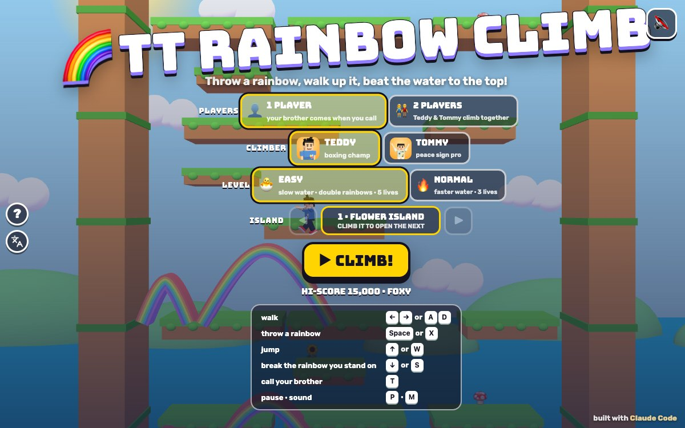

# TT Rainbow Climb

Press **?** any time (or tap the round **?** button on the left edge) to see the keys. The game waits while you look.
Tap the language button under it (the A文 icon) to switch between English and 中文; the dashboard and every game remember the choice.

**中文：** 彩虹桥：Teddy 和 Tommy 扔出彩虹当桥，走上去，一直往高处爬！彩虹落在小怪物身上就把它变成水果；跳到彩虹上把它踩碎，砸中下面的小怪物还会掉出宝石。水一直在涨，快爬到小岛顶上的宝箱！一共 4 座小岛，每座 4 关。

A climbing game on tall islands, starring Teddy and Tommy. Press Space and a rainbow arches out the way you face: it's a bridge you can walk up, so walk to its top and throw the next one. Rainbows bonk the critters they land on (they turn into fruit). Jump on a rainbow to break it and it falls, bonking every critter below (they drop gems). Meanwhile the water slowly rises from the bottom, so keep climbing to the treasure chest at the top. Collect the 7 coloured gems for a bonus. 4 islands of 4 rounds.

A 3D game for the boys, built with Claude Code from plain JavaScript and Three.js on the shared Claude Games kit. The climbers are the kit's blocky Teddy and Tommy; the critters, islands and rainbows are our own toy models. There are no image, model or audio files: every texture is painted on a canvas and every sound is synthesised. The name, the characters, the islands and the sounds are our own; nothing is copied from any arcade game. Nobody gets hurt: a bonked critter spins, puffs into confetti and leaves fruit behind, a critter the water reaches floats away in a bubble ("SOAKED!"), and a climber the water reaches says "SPLASH!" and floats up in a rubber ring.

## Play

- **Double-click `index.html`.** It works offline because Three.js and the kit are copied into `kit/`. Without internet the title font falls back to Arial Black.
- **Send one file:** `dist/rainbow-climb-tt.html` is the whole game in one page, about 850 KB. AirDrop or email it, then open it in a browser.
- Rebuild that file after any edit: `python3 kit/tools/bundle.py . --name rainbow-climb-tt`

On the title screen pick **1 PLAYER** (then the climber: Teddy or Tommy) or **2 PLAYERS** (Teddy and Tommy climb together), the level, the **ISLAND** (every island you finish opens the next one, for each level), and press **▶ CLIMB!** Behind the menu the autopilot climbs a demo.

**Levels:**

- **🐣 EASY** (the default, for Tommy, 5): the water waits 6 seconds, then rises slowly (0.15 m a second); every throw makes a **double rainbow** (two arches in a row, reaching twice as far); rainbows last 10 seconds; only a big drop onto a rainbow breaks it; 5 lives; fewer, slower critters; an oops gives 3 seconds of blinking safe time. Gems always come in a colour you still need.
- **🔥 NORMAL** (for Teddy, 8): the water starts after 3 seconds and rises faster (0.25 m a second, a little faster on every island); one rainbow a throw, lasting 7 seconds; a small hop breaks a rainbow; 3 lives; more and faster critters.

## The islands

- **Rainbows:** **Space** throws a rainbow the way you face, from your feet, in a quarter of a second. It's solid: walk up it, stand on top, walk down the other side, land on it from a little hop. From the top, throw the next one, or jump to the ledge above. You can throw in the air too, and land on the new one. Next to a wall there's no room ("NO ROOM!"): turn round. You can have 3 rainbows (6 on EASY); the oldest fades when you throw more, and a rainbow blinks just before it fades.
- **Bonking:** a growing rainbow bonks any critter it sweeps over or lands on. The critter spins, puffs into confetti and leaves a fruit (🍎 🍌 🍇 🍓 🍒 🍉 🍑 🍍) that falls onto the ledge below: grab it. Several critters with one rainbow count double each time.
- **Breaking:** jump on a rainbow (land on it from a jump), or press **↓** standing on it, and it **breaks** and falls. A falling rainbow bonks every critter it drops on, and those leave a **gem** instead of a fruit. The gem's colour depends on where the critter was, across the island in 7 strips from red to violet. Collect all **7 gems** on one island for the **RAINBOW BONUS!**: +10,000 and an extra life. The row of gems under your score shows which colours you have.
- **Ledges** are one-way: jump up through them from below and land on top. They're too far apart to jump (a jump lifts you about 2.3 m, the rows are 3.2 m apart), so rainbows are the way up. EASY adds a few little step ledges between rows.
- **The water** rises on a timer from the bottom. The **WATER** box shows how far it is below the lowest climber, and goes pink when it's close; "HURRY! THE WATER IS RISING!" when it gets near. If it reaches you: **SPLASH!**, a life, and a rubber ring floats you up onto a ledge above the water (and the water drops back a bit). Critters the water reaches float away in bubbles.
- **The screen scrolls up only.** It follows the highest ledge or rainbow anybody has stood on. Fall below the bottom of the screen and you **float back up in a bubble** onto a ledge on the screen (that never costs a life).
- **Critters** walk along the ledges (they turn at the ends, and at the foot of a rainbow, so a rainbow is a little wall) or flutter across. Bumping into one is an **OOPS!**: a life, dizzy stars, and a few seconds of blinking when nothing can bump you.
- **The goal:** each round's top is a full-width ledge with a treasure chest under a rainbow **GOAL!** flag. Stand on it: **ROUND CLEAR!**, the chest opens, the climbers do their signature moves, and the next round starts.

The 4 islands, each with 4 rounds that get taller (from 7 to 13 rows of ledges under the goal) and busier:

| Island | Critters that walk | Critters that fly |
|---|---|---|
| **FLOWER ISLAND** (花花小岛) | ladybugs | bumble bees |
| **TOY ISLAND** (玩具小岛) | wind-up mice | toy planes |
| **CANDY ISLAND** (糖果小岛) | gummy bears | wrapped bonbons with wings |
| **CLOUD ISLAND** (云朵小岛) | fluffy sheep | cheeky little clouds |

**Points:** a bonked critter 100, a fruit 500 (1,000, 2,000, 4,000 for more critters with the same rainbow), a gem 1,000, the rainbow bonus 10,000, a round 1,000 to 4,000 (round 1 to 4 of the island), the brother's treat 500, a high five 50.

**HI-SCORE:** the HUD shows the best score for the level, the island and round, and the hearts (shared in 2 players). The **TOP CLIMBERS** board keeps the best five for each level, with 🦊 Foxy and 🐸 Froggy's scores to beat.

## 2 players

Teddy and Tommy climb the same island together, each with his own score and rainbows, sharing the hearts. Either brother can walk on (and break) either brother's rainbows. The screen follows the higher climber; if the other one ends up below the bottom of the screen, a bubble carries him up onto the screen. Whoever reaches the goal clears the round for both. **T** is a high five (+50 each, and confetti).

## Controls

| | 1 player | 2 players: Teddy | 2 players: Tommy | Touch |
|---|---|---|---|---|
| walk | ← → or A D | A D | ← → | ◀ ▶ |
| throw a rainbow (the way you face) | Space or X | Space or F | Enter or L | 🌈 RAINBOW |
| jump | ↑ or W | W | ↑ | ⤴️ JUMP |
| break the rainbow you stand on | ↓ or S | S | ↓ | jump on it |
| call your brother (2 players: high five) | T | T | T | tap his face (✋) |
| pause · sound | P or Esc · M | | | ❚❚ · 🔊 |

- You can steer in the air: hold ← or → during a jump.
- **Touch:** the buttons show up on phones and tablets, clear of the play area and of the kit's buttons on the left edge. In 2 players each brother gets his own pad (Teddy's on the left, Tommy's on the right).
- **Menus:** on the title screen 1 and 2 pick the players, E and N the level, C swaps the climber, ← → pick the island, Enter or Space starts. Paused: P, Esc or Space go on, Q goes to the menu. Results: Enter plays again, Esc goes to the menu.

## Call your brother (companion mode)

Call the other brother (`Kit.roster.buddyFor`: Tommy for Teddy, Teddy for Tommy) with **T**, by tapping his face button, or by clicking his face under your score, **as often as you like**: as soon as his staircase is up, the next call brings him again.

- **He pops in on a little cloud** next to you at his roster `buddyScale`.
- **He does his signature move:** Tommy's Y with peace fingers ✌️; Teddy's boxing, or his jump shot with a 🏀.
- **He tosses you a treat** (🍦 💧 🧃 🍪 🍉 🍌, a different one each call): +500.
- **Then the game's helper:** "TOMMY SAYS: CLIMB MY RAINBOW STAIRS!" He throws a **giant rainbow staircase**: four big arches, each starting at the top of the one before, about 11 m up toward the open side. Walk up it! The stairs bonk any critter they land on, and last 14 seconds.
- **2 players:** both brothers are climbing, so T is a **HIGH FIVE! ✋** (+50 each).

## The end

Clear the 4th round of an island: **FLOWER ISLAND CLEAR!** (and the next island opens on the title screen). After the 16th round it's **ALL ISLANDS CLIMBED!** When the lives run out (or after the last island), the climber (in 2 players both brothers) does his signature move in front of the island with confetti, and the results show the score, the **TOP CLIMBERS** board (**⭐ NEW HI-SCORE!** or **⭐ ON THE BOARD!**) and **↻ PLAY AGAIN**.

## How it works, and how it's tested

- `js/islands.js`: the 4 islands and their 16 round layouts, each made from a fixed seed (so a round is the same every time). `js/sim.js`: the rules, in fixed 1/60 s steps: walking, jumping, one-way ledges, rainbows (growing, walkable, fading, breaking and falling), bonks, fruit and gems, the water, the screen scrolling, bubbles and rubber rings, critters, points, lives, 2 players and the brother's staircase. `js/bot.js`: the autopilot (it bonks critters close in front, jumps to ledges in reach, otherwise throws a rainbow and walks up it, and waits a moment when a critter is on the ledge it's climbing toward). None of them uses Three.js, so node runs them.
- `js/art.js` builds the islands (each round's ledges are merged into a few meshes), the rainbows (7 bands, grown from the start to the tip), the critters, the water and the effects; `js/sfx.js` the sounds (all through `Kit.sound`, so the mute switch covers them; counted in `RC.sfx.log`); `js/game.js` the camera, screens, keys, touch, HUD, celebrations and the test hooks. `js/friends.js` adds 🦊 Foxy and 🐸 Froggy to the roster (copied from TT Ice Climb). The name lives in `js/title.js`.
- **The headless check:** `node tools/check.js` (or `game.check()` in the page), 11 checks in under a second:
  - *rainbowWalk:* a rainbow is solid and walkable: walking up it the feet stay on the curve (off by 0.000 m over 29 steps, never in the air), he stands on its top for 3 seconds, and a soft landing from a hop holds.
  - *brokenFalls:* a rainbow broken with ↓, and one landed on from a jump, falls, bonks the critter below (a gem) and is gone.
  - *waterRises:* the water waits, then rises exactly the same every 10 seconds (1.5 m on EASY, 2.5 m on NORMAL); standing still, it splashes you, costs a life and floats you up above it.
  - *autopilot:* the autopilot climbs all 16 rounds on 🐣 EASY, in 1 player and in 2 players (the slowest round about 40 seconds); *autopilotNormal* does all 16 on NORMAL too.
  - *scrollsUpOnly:* while the autopilot climbs four rounds the screen never moves down and reaches the top; climb high, drop to the floor, and the screen stays put while a bubble brings you back onto it.
  - plus: the rainbow goes the way you face and bonks a critter where it lands (fruit); → and ← and both walls; jumping up through a ledge; EASY vs NORMAL; the 7 gems, the goal and the last round; the brother's treat and staircase (walked up 11 m), calling him again, and the high five in 2 players.
  - **It can fail:** `node tools/check.js --fail` (or `game.checkFail()`) switches on six sabotages one at a time (rainbows that aren't solid, a rainbow thrown backwards, a falling rainbow that bonks nothing, water that never rises, an autopilot that never throws, a screen that follows you down) and every one is caught.
- **The real-key play check:** `game.playCheck()` in the page (377 checks, about 3 seconds) presses keys with real `keydown`/`keyup` events on `window` and taps the touch pads with pointer events, never the autopilot, and reads positions on the screen from the drawn meshes. On all 16 rounds, for Teddy, Tommy and both brothers in 2 players (A D and ← →, each moving only his own brother), with keys and with touch: → moves right and ← moves left on screen, the rainbow's drawn tip lands right of him facing → and left facing ←, walking onto it goes up the screen, and the jump goes up and lands. Nothing leaves you stuck: an oops, a splash and the rubber ring, the bubble after dropping off the screen, a rainbow fading or breaking under you, both walls (throwing into a wall just fizzles), jumping up through a ledge with → held, the brother's visit (three calls, three staircases), a key held through pause or a lost focus, the next round, 2 players on their own keys, and a "keyboard kid" mashing keys with the critters about on every round. `game.playCheck('mirror')` (left and right swapped, 243 failures) and `game.playCheck('stuck')` (the keys stop working after an oops) both fail it.
- **In the browser** (headless Chrome over the DevTools protocol, `tools/shoot.js` with the step files in `tools/`, the page opened from the disk): every screen in 中文 (`Kit.lang.untranslated()` returns `[]` on the title, the ? panel, the 2-player touch title, play, the brother's stairs, bonks, fruit, gems, CRACK, NO ROOM, OOPS, HURRY, the rainbow bonus, pause, round clear, the next round, island clear, the next island, game over in 1 and 2 players, and the all-islands results), no Chinese in English mode (only the kit's language button, which names 中文 on purpose), sounds counted in code while muted, the ? panel freezing the game with real frames, phone 390x844, 844x390 and 740x360, iPad 768x1024, 1024x768 and 820x1180, and 1200x750, all with touch in 1 and 2 players (no scrolling, no button over another, nothing under the kit's left-edge buttons, the play area clear of the touch pads, the smallest tap target 62 px), and `dist/rainbow-climb-tt.html` from `file://` with no page errors (the play check and the headless check pass there too).
- `docs/screenshot.jpg` is the title at 1200x750: `node tools/shoot.js tools/shots.json docs 1200 750`.

## Not verified

- **Sound:** every sound is synthesised and counted in code, but nobody has listened to it (tests ran muted): the rainbow sparkle, the crack, the bonks, the splash, the fanfares.
- **Real devices:** touch was driven with synthetic pointer events in emulated phones and iPads, not on a real iPad or iPhone. The frame rate was only seen in software rendering (about 150 draw calls a frame), not on an older iPad. On a phone held upright the island makes the climbers small (the title suggests turning it sideways).
- **Real kids:** how hard Easy and Normal feel was tuned with the autopilot, not with Teddy and Tommy; the autopilot climbs a round in 10 to 40 seconds, a kid will take longer (on EASY the water needs about 3 minutes to reach the top of the first round).
- **Long sessions,** a real Finder double-click, the home-screen icon on a real iPad, and the offline font fallback.
